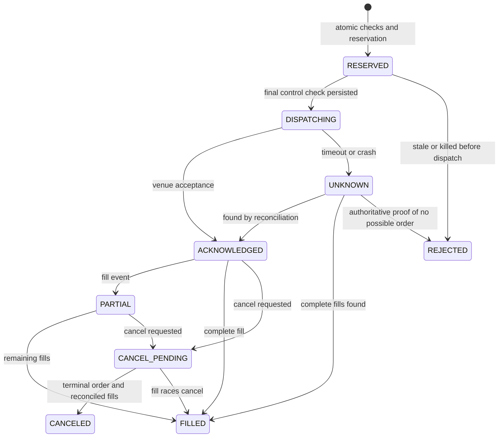

# Autonomous crypto agent architecture

Status: **APPROVED — operator explicitly approved this architecture and requested continuation on October 17, 2026.** Based on the operator-approved [specification](../specs/2026-10-16-autonomous-crypto-agent-design.md). Backend and data specialist design reviews have been reconciled into this document. Implementation planning is now authorized; the Plan gate precedes implementation. The repeated original request preserves the objective and prior approvals.

## 1. Decisions and boundaries

Use the existing Python repository, one host, one managed account, SQLite, and a single order authority. Default development mode is a new paper account. Coinbase Advanced spot/USD is the first adapter target because it is already integrated; venue availability, bounded-order behavior, listings, and permissions must pass verification before live promotion. No alternate venue or derivatives adapter silently activates.

There are four roles in separate processes/containers. `worker.py` exposes an explicit role entrypoint rather than embedding background trading in the web server:

| Role | Responsibility | Credentials and writes |
|---|---|---|
| authority | Public/private event ingestion, causal state, ledger, policy, risk, order submission, release activation, control API | Sole exchange trading secret and sole writer of authoritative database; no reasoning-model credentials |
| reflex | Receive immutable numeric state, compile approved questions, call Jev, validate typed answers | Jev key only; no venue key or writable ledger; returns judgments |
| brain | Research, valuation, exception review, nightly metrics and candidate bundles | Configured reasoning-provider key and public research access; read-only session exports; writes proposal artifacts only |
| dashboard | Read status and submit authenticated operator commands | Local control credential; no venue/model secrets or direct ledger writes |

Approved deterministic policy/risk code runs in authority. BRAIN and REFLEX cannot authorize a trade by changing a file or returning a field. Separate mounts and role-specific environment secrets enforce the process boundary; this does not claim resistance to a compromised host administrator.

Authority holds a kernel process lock on the stable account-volume lock file for its entire lifetime. No execution standby, multiple replicas, shared network filesystem, or lease-based automatic failover. A worker cannot become ready without the lock and successful startup reconciliation. A durable authority generation and control epoch aid audit and stale-command rejection; the venue does not enforce those values, so they are not a substitute for the process lock.

Control and judgment messages use bounded, versioned JSON over Unix sockets with filesystem permissions, peer checks, a role-specific authentication token, request IDs, and size limits. Authority allows only registered command types. BRAIN never receives an operator token. Only hashes and bounded records cross the interfaces; no arbitrary code, shell command, SQL, file path, or free-form trading instruction is executable.

## 2. Concrete file and module structure

The following are planned files, not scaffolding created in this phase. Modules own the responsibilities shown here; all shared domain types live in `contracts.py`.

```text
bot/autonomous/
  __init__.py
  contracts.py                 immutable domain types, enums, typed errors
  state.py                     causal book/features and compact encoding
  jev_client.py                question compilation, HTTP and answer validation
  policy.py                    deterministic entry/exit/escalation decisions
  risk.py                      pure hard-limit assessment and latch transitions
  sizing.py                    calibrated quarter-Kelly and capacity caps
  execution.py                 sole order authority, venue port, recovery
  ledger.py                    migration, journal, risk state, projections
  worker.py                    authority/reflex role startup and event loops
  control.py                   Unix-socket protocol and operator authentication
  release.py                   bundle verification and gated atomic activation
  calibration.py               supported outcome estimates and Brier evaluation
  brain.py                     reasoning-provider port and bounded proposals
  nightly.py                   brain role scheduler and review jobs
research/autonomous/
  __init__.py
  evidence.py                  source observations and causal evidence manifests
  valuation.py                 token-attributable valuation and eligibility
config/autonomous/
  risk.yaml
  schemas/
    aave.json
    hype.json
    pendle.json
    aero.json
    ldo.json
    ondo.json
data/migrations/
  001_autonomous_ledger.sql
tests/autonomous/
  __init__.py
  test_causality.py
  test_state.py
  test_jev_contract.py
  test_policy_boundaries.py
  test_risk_limits.py
  test_sizing.py
  test_execution_recovery.py
  test_ledger.py
  test_control.py
  test_nightly.py
  test_release_promotion.py
  fixtures/
    causal_book.jsonl
    partial_fill_cancel.jsonl
    uncertain_submit.jsonl
    external_flows.jsonl
    jev_responses.json
deploy/
  autonomous.compose.yml
docs/
  ADR/2026-10-16-brain-reflex-boundaries.md
  architecture/2026-10-16-autonomous-crypto-agent.md
  plans/2026-10-16-autonomous-crypto-agent.md
  reviews/2026-10-16-autonomous-crypto-agent.md
  runbooks/autonomous-agent.md
.github/workflows/
  autonomous-agent.yml
```

Runtime root is configurable, default `/var/lib/surge/autonomous` inside the mounted account volume: `ledger.sqlite3`, `authority.lock`, `sockets/`, `events/`, `exports/`, `bundles/`, and `proposals/`. Each role sees only the needed subdirectories. SQLite WAL and shared-memory files stay on the same local persistent volume. The database is configured with foreign keys, WAL, full synchronous commits, bounded busy timeout, and explicit immediate write transactions. Backups use a consistent SQLite backup and content-addressed artifact manifest, not a live main-file copy.

## 3. Public contracts and scalar types

These are design signatures, not executable implementations. `ID`, `Hash`, and enums are bounded strings; timestamps are signed 64-bit UTC Unix **microseconds** (`*_us`); durations and deadlines within a boot use monotonic nanoseconds. `Money` is checked signed 64-bit USD microdollars. `Quantity`, `Price`, NAV and units use canonical decimal strings in storage and Python `Decimal` at precision 50, with at most 38 significant digits and instrument-scale checks. No monetary SQLite REAL arithmetic. Reject overflow, nonfinite values, excessive precision, and negative sizes. Feature/model probabilities are finite floats with declared precision.

```python
# state.py
class StateEngine:
    def ingest(self, event: SourceEvent) -> IngestResult: ...
    def snapshot(self, symbol: str, cutoffs: CausalCutoffs) -> NumericSnapshot: ...

def encode_state(snapshots: tuple[NumericSnapshot, ...], context: SharedContext,
                 dictionary: FieldDictionary,
                 token_counter: ProviderTokenCounter) -> EncodedState: ...

class ProviderTokenCounter(Protocol):
    def count_state(self, canonical_state_json: str) -> TokenCount: ...

# jev_client.py; runs only in reflex role
def compile_questions(bundle: ApprovedBundle,
                      state: EncodedState) -> QuestionBatch: ...

class JevClient:
    async def judge(self, state: EncodedState, bundle: ApprovedBundle,
                    request: JudgeRequest) -> DecisionBatch: ...

# calibration.py / sizing.py / policy.py / risk.py; pure functions
def estimate_edge(forecast: CandidateDecision, snapshot: NumericSnapshot,
                  artifact: CalibrationArtifact) -> EdgeEstimate | UnavailableEdge: ...
def size_entry(edge: EdgeEstimate, account: AccountView,
               market: MarketRules, limits: RiskLimits) -> SizedProposal | SizeRejection: ...
def evaluate_candidate(decision: CandidateDecision, snapshot: NumericSnapshot,
                       bundle: ApprovedBundle, edge: EdgeEstimate | UnavailableEdge,
                       account: AccountView) -> PolicyResult: ...
def assess(proposal: OrderProposal, account: AccountView, control: ControlState,
           limits: RiskLimits, market: MarketRules, now_us: int) -> RiskVerdict: ...

# execution.py; sole submission boundary
class OrderAuthority:
    async def submit(self, command: SubmitOrderCommand) -> IntentReceipt: ...
    async def cancel(self, command: CancelOrderCommand) -> IntentReceipt: ...
    async def control(self, command: ControlCommand) -> ControlReceipt: ...
    async def reconcile(self, reason: ReconcileReason) -> ReconcileReport: ...

class VenuePort(Protocol):
    async def submit(self, intent: PreparedIntent) -> VenueOrderResult: ...
    async def lookup(self, reference: OrderReference) -> VenueOrderResult: ...
    async def cancel(self, reference: OrderReference) -> VenueOrderResult: ...
    async def read_account(self) -> VenueAccountSnapshot: ...
    async def read_fills(self, cursor: FillCursor) -> FillPage: ...
    async def market_rules(self, symbol: str) -> MarketRules: ...

# ledger.py; called only by authority
class Ledger:
    def reserve_intent(self, proposal: OrderProposal, expected: AccountRevision,
                       generation: int, decision: DecisionReference) -> PreparedIntent: ...
    def mark_dispatching(self, intent_id: str, generation: int) -> PreparedIntent: ...
    def append_order_event(self, event: OrderEvent) -> AppendResult: ...
    def account_view(self, account_id: str) -> AccountView: ...
    def append_review_job(self, job: ReviewJob) -> AppendResult: ...
    def export_session(self, cutoff: SessionCutoff) -> SessionArchive: ...

# evidence.py / valuation.py; brain research process
class EvidenceSource(Protocol):
    async def fetch(self, request: EvidenceRequest) -> tuple[EvidenceObservation, ...]: ...
def evaluate_thesis(candidate: CandidateDefinition,
                    evidence: EvidenceManifest) -> ThesisAssessment: ...

# brain.py / nightly.py / release.py / worker.py
class BrainPort(Protocol):
    async def review(self, job: ReviewJob, archive: SessionArchive) -> ReviewProposal: ...
async def review_session(archive: SessionArchive, brain: BrainPort,
                         evaluation: EvaluationRunner) -> ReviewReport: ...
class EvaluationRunner(Protocol):
    def evaluate(self, bundle: CandidateBundle, archive: SessionArchive,
                 split: EvaluationSplit) -> EvaluationResult: ...
def validate_bundle(bundle: CandidateBundle,
                     approvals: tuple[GateApproval, ...]) -> ApprovedBundle | BundleRejection: ...
async def run_worker(config: WorkerConfig, dependencies: WorkerDependencies) -> None: ...
```

Boundary records are immutable and include:

| Record | Required fields |
|---|---|
| SourceEvent | event ID, source/stream/instrument, logical key, revision, event/received/known timestamps, optional sequence/block reference, superseded ID, typed payload and payload hash |
| CausalCutoffs | candle close UTC, fixed knowledge cutoff UTC, monotonic inference deadline, boot ID |
| NumericSnapshot | instrument/candidate ID, snapshot hash, cutoffs, ordered feature tuple, validity mask, complete lineage manifest hash, account revision |
| EncodedState | canonical numeric JSON, SHA-256, field-dictionary hash, exact included candidate IDs/order, tokenizer identity and count, snapshot references |
| JudgeRequest / DecisionBatch | request ID, state/bundle/model identities, deadline and receive time; exact per-candidate answers or typed rejection reason; raw response hash |
| CandidateDecision | specified regime/direction/quality/risk enums, direction distribution and confidence, all other Choice confidences, Noul probability, derived toxic-flow bool |
| CalibrationArtifact | model/schema/dictionary/label/cost hashes, supported instruments and regimes, training cutoff, validity window, calibration mapping, independent sample counts, payoff estimates and uncertainty/tail checks |
| EdgeEstimate | conservative calibrated outcome p, W/L per dollar notional, cost convention, validity horizon, artifact identity, supported-input proof |
| AccountView | account/mode/revision, liquidation equity, units/NAV/high-water/day-open NAV, balances/bases, holdings, pending reservations, open/unknown intents, reconciliation identity and timestamps |
| OrderProposal / PreparedIntent | deterministic action identity, account, candidate/instrument, side/base quantity, bounded limit price, fee buffer, release/decision/candle references, reducing-only semantic, control epoch, deadline; prepared form adds committed reservation and client order ID |
| MarketRules | venue/instrument/base/quote, spot permission, tick/lot/minimum limits, fee bound, max price precision, capability-verification hash and expiry |
| ControlState | mode, permit, hard kill, durable drawdown/daily/crisis halts, control epoch, boot/deadman deadline, active release, reconciliation readiness |
| RiskVerdict / PolicyResult | allowed/propose bool, stable reason codes, required halt/escalation transitions, input revision/hash references; proposed action is optional and never self-authorizing |
| TokenCount | state token count, tokenizer/provider-bound identity, proof method and compatibility hash; unavailable proof raises TokenAccountingUnavailable |
| SessionArchive | immutable cutoff, account/reconciliation IDs, consistent database export, ordered event/forecast/outcome manifests and hashes; no secrets |
| CandidateBundle | parent hash, model/schema/dictionary/tokenizer/policy/risk/calibrator/code identities, evidence manifest and expiry, candidate list, evaluation manifests and gate approvals |

Expected refusals return typed `Hold`, `RiskRejection`, `SizeRejection`, `UnavailableEdge`, `BundleRejection`, or `PendingReconciliation` values, each with stable reason codes and references. Unexpected failures raise `PersistenceUnavailable`, `ProviderUnavailable`, `VenueUnavailable`, `StateUnavailable`, `TokenAccountingUnavailable`, `ContractViolation`, or `AuthorityUnavailable`. No exception becomes approval. Control protocol returns 202-style pending receipts for queued work; completed status must be queried by request ID.

## 4. Causal ingestion and state encoding

Authority owns the canonical public book, private account stream, snapshots, and feature math. At each accepted sequence update it materializes the required numeric instrument state in memory. It archives original book deltas in bounded compressed segments and periodic full-book checkpoints with hashes, event/receipt ranges and sequence continuity; archive write failure inhibits new entries. Finalized segment manifests enter SQLite only after flush, fsync, and atomic rename. Orphan segments are verified on recovery; decisions cannot reference an uncommitted segment. Every snapshot used for a judgment is persisted with full lineage first.

The first release consumes centralized sequence streams. Block hashes, finality and reorg invalidations are required for onchain research observations; they do not turn centralized updates into blockchain blocks. No chain adapter can declare finality without a verified source-specific policy.

For market features, include only source observations with `event_at_us <= candle_close_us`, `received_at_us <= knowledge_cutoff_us`, and `known_at_us <= knowledge_cutoff_us`. Select the latest eligible revision per logical key. Revisions and invalidations are append-only and knowledge-timed. Freeze the knowledge cutoff once for the entire batch; a later response cannot change its state. Ledger events used in the Jev snapshot follow the same cutoff. **Execution risk uses a separately refreshed current AccountView**, including fills after the candle cutoff; it never trades from historical snapshot inventory.

Feature definitions: mid and spread from uncrossed top quotes; imbalance from comparable bid/ask base depth within a symmetric 10-bps band; realized volatility from 60 completed one-minute mid-price log returns, sample standard deviation, with explicit warmup count. Compact state carries unannualized volatility; reporting can apply the dictionary's annualization. Carry-forward interpolation across missing minutes is forbidden. Inventory and liquidation equity come from ledger plus executable valuations; no model arithmetic.

Shared compact array, versioned positions:

`[dictionary_version, candle_close_ms, btc_return_1h, eth_return_1h, btc_trend, eth_trend, dominance_change_7d, stablecoin_change_7d, funding_change, oi_change_24h, macro_minutes, volatility_percentile, gross_fraction, drawdown, daily_loss, cash_headroom, shared_validity_mask]`

Each candidate row:

`[candidate_id, mid, spread_bps, imbalance, rv_60m, rv_samples, return_1h, base_inventory, inventory_usd, eligible, evidence_age_minutes, evidence_expiry_minutes, thesis_condition_bits, position_headroom, estimated_roundtrip_cost_bps, candidate_validity_mask]`

The transmitted state is `[shared_array, candidate_rows]`. Dictionary entries define scale, precision, directionality, windows, expected bounds and every bit. Trend and thesis bits are deterministic categorical encodings, not prose or hidden model estimates. Unknown numeric slots use a fixed placeholder **with the validity bit false**; a zero placeholder is never treated as an observed zero. Complete invalidity/freshness handling is repeated in each independent question's static rubric.

The whole state must be **<400 provider tokens** using a pinned provider tokenizer or a documented provider-approved upper bound. A byte/character heuristic and total request usage are insufficient evidence of state-only compliance. Question instructions and field definitions are static, separately budgeted, versioned material; fresh facts cannot be smuggled through instructions. Preselect at most five long-eligible candidates by approved deterministic ranking and ID tie-break. If encoding exceeds budget, remove the lowest-ranked candidate and recompile all questions; log excluded candidates as HOLD. Never omit risk/validity fields. If mandatory shared state plus one complete candidate does not fit, stop and return to design. No measured tokenizer/budget compliance is claimed yet.

No eligible candidates means an audited empty-universe HOLD. Jev need not be called to discover that all candidates are deterministically disabled. Continuous portfolio-risk checks still run.

## 5. Jev judgment, calibration, policy

REFLEX receives one complete encoded batch per accepted hourly candle and returns five independent answers per included candidate in one vendor call. The versioned schema compiler explicitly includes the candidate ID/row, horizon and definitions in **each** question; IDs alone do not encode instructions and sibling answers are invisible. Four Choices implement regime, direction, integer quality 0–3, and advisory risk. One Noul supplies toxic-flow probability; code maps probability >=0.50 to true. Schemas retain the six candidate-specific evidence conditions in the approved spec. ONDO stays neutral/research-only for spot. No candidate currently has approved eligibility or a calibrated edge.

Jev protocol facts are based on the locally captured first-party documentation and the dated links in the approved spec; this architecture adds no claimed provider SLA. The initial model pin is the spec's documented `jev-1.14.0`, subject to authenticated availability verification. Require exact response keys/types, finite complete distributions summing to 1 within 1e-6, correct selected argmax, integer quality conversion from exact Choice labels, pinned resolved model, and matching local request/state/bundle. Validate confidence against the documented formula within declared floating tolerance; a contradiction rejects the batch. Unknown output, ties without the selected label among maximizers, wrong model or late response yields HOLD. Provider error bodies are never parsed as decisions.

Initial technical timeout budgets for validation, not performance claims: one Jev request, 1,000ms total deadline, zero automatic SDK retries, and 2,000ms maximum candle-snapshot age at dispatch. Any earlier runtime deadline wins. Both must be validated against observed latency and reviewed before live promotion. Provider exceptions and a missing Jev key leave entries disabled; paper replay can use explicit test fixtures, never synthetic live forecasts.

Authority independently validates the returned batch and evaluates the approved entry gates: quality >=2, direction confidence strictly >0.80, nonneutral supported direction, risk_state safe, no toxic flow, current eligibility, supported calibrated positive edge, then deterministic sizing and hard risk. No manual/dashboard source can fabricate a qualifying decision for an entry. Explicit operator reductions and deterministic protective exits do not require model confidence, but still require hard controls and common execution authority.

For escalation, confidence <0.60 on any of the four decision-critical Choices pauses that candidate and creates a deduplicated BRAIN job. Any crisis answer pauses account-wide new exposure immediately. Independently computed stress limits can also halt trading when Jev says safe. Review jobs include full internal lineage and account state; that richer internal review context is not transmitted to Jev. BRAIN proposals cannot clear latches or approve themselves.

Calibration uses Jev probabilities as inputs, plus approved conditioning variables, to estimate **executable net-positive outcome** probabilities. Direction confidence is never substituted for p. Map support is exact across model/schema/dictionary/label/cost versions, instruments, regimes and validity dates. Unsupported or insufficient independent observations yield `UnavailableEdge` and zero entry size. Separate cash-flow theses from four-hour timing evidence.

Default binary outcome: net positive P&L from the first eligible postdecision executable quote to the fourth completed hourly candle after that quote, or an earlier preapproved protective exit, whichever occurs first. Persist the exact horizon close before scoring. Direction labels use terminal long/short cost hurdles with neutral for neither; labels are versioned separately from binary policy outcomes. Missing executable quotes, unavailable short borrow, or unobserved latency/depth make the corresponding counterfactual unresolved, not a fabricated fill.

Bootstrap calibration from immutable historical executable observations where causal availability is established, then collect raw Jev judgments and counterfactual outcomes in shadow mode while entries remain disabled. Fit the outcome map on training data and assess it on unseen future data before admitting a calibrated edge. Unknown outcome probabilities remain null; synthetic paper outcomes and model self-ratings cannot bootstrap live eligibility. No fills are required merely to collect shadow labels.

Sizing uses the spec's loss-budget Kelly convention: `b=W/L`, `f*=max(0,p-(1-p)/b)`, loss budget `equity*min(0.25*f*,0.0025)`, and notional `loss_budget/L`, then smaller liquidity, cash and portfolio caps. W/L are net-of-cost conditional outcomes and exclude no tail observations. Check positive net expectation independently, fit uncertainty conservatively, and reject unsuitable tail distributions. Actual funding at risk can exceed the binary-loss approximation in a gap; hard position caps apply regardless.

## 6. Durable accounting and risk

Maintain a USD functional double-entry journal with native-asset quantity changes. Each transaction must balance signed USD microdollar postings to exactly zero and pass native-quantity conservation including fees; all postings, fill deduplication and reservation updates commit atomically. Derive balance and weighted-average cost projections at a journal sequence watermark. Rebuildable projections never replace journal evidence.

Buy notional N with USD fee F: inventory cost +N, fee expense +F, cash −(N+F). Sell proceeds N, removed basis B, USD fee F: cash +(N−F), fee expense +F, inventory −B, realized-profit account −(N−B). Native base quantities track actual venue delivery, including base-paid fees. A third-asset fee disposes that asset at verified USD value and its existing cost basis; missing conversion/basis makes accounting unready. Rounding differences use an explicit bounded rounding account, not unexplained P&L.

Liquidation equity is USD cash plus conservative executable liquidation value of all held assets minus liabilities, including estimated remaining exit fees/slippage. Do not subtract fees already charged to cash again. Reserved cash remains owned equity but cannot be spent twice. Unknown holdings, stale conversion marks, insufficient liquidation depth, unexplained balances, nonpositive equity or arithmetic failure inhibit entries. Full account equity is used, not just bot-tagged positions.

Unitized NAV prevents external capital flows from resetting loss limits. At reconciled initialization use units U>0 and NAV n=E/U. A verified external flow F issues/redeems units `delta_U=F/n` at preflow NAV; E becomes E+F, preserving NAV. Actual transfer/valuation costs remain losses. Unexplained venue differences are never classified as deposits. High-water NAV H only increases; drawdown is `max(0,1−n/H)`. UTC daily loss is `max(0,1−n/n_day_open)`. Persist H and the valid boundary opening NAV, not a favorable later mark. Missing baseline blocks entries. Full withdrawal, invalid preflow mark, or zero units closes/halts the account; new money cannot clear an existing latch.

Hard controls are rechecked in authority at reservation and immediately before dispatch:

| Control | Behavior |
|---|---|
| Drawdown >=15% | Persist a nonresetting drawdown latch; cancel entries; reducing-only protection only under valid non-hard-killed control. |
| Daily NAV loss >=2% | Block/cancel entries for the day; next UTC day requires valid opening mark and reconciliation; drawdown/crisis/hard-kill latches remain. |
| Per-asset position <=5%, gross <=20% current equity | Include worst-case outstanding entry fills and reservations; reductions cannot be credited before fills. Price moves above caps stop entries and invoke reducing policy, not a false claim of invariant market value. |
| Per-entry modeled loss <=0.25% equity and <=quarter Kelly | Cap each proposal and its reservation. Also cap aggregate outstanding modeled loss at 1% equity; reductions release budget only after confirmed execution. |
| Cash and holdings | Reserve worst-case limit notional plus fee bound; reserve base for sells. Spot cannot sell more than unreserved owned units. No leverage, negative holdings or assumed stablecoin/USD equivalence. |
| Freshness | Public book no older than 2s; private-stream heartbeat no older than 5s; completed full reconciliation no older than 15s; sequence gaps or stale held-asset valuations inhibit entries. Values are initial conservative technical settings requiring validation. |
| Bounded execution | Only verified limit/IOC semantics; rounded quantities, tick price bounds, minimums, fee schedule, depth and conservative net-cost edge required. No market-order fallback. |
| Controls | Explicit mode/armed permit, active approved release, healthy independent operator deadman, current process/control epochs, no hard kill, complete readiness required. Every exit uses the same checks applicable to reducing orders. |

The aggregate pending-loss cap is an added conservative architecture proposal, not a fitted strategy parameter. Daily/model/cost/liquidity parameters are immutable release inputs. The operator deadman cannot be refreshed by Jev/BRAIN or a healthy-worker heartbeat. A daemon heartbeat only proves process liveness. Expired operator authorization disables dispatch; live permit durations and renewal procedure are established at the deployment gate.

Predetermined exits: horizon expiry requests a bounded reduction; crisis/drawdown can trigger a bounded full-reduction attempt. Failed/partial exits stay visible, retain reserved inventory and retry only after reconciliation with a distinct approved action slot. A hard kill forbids new exits as well as entries. Cancel requests and reconciliation remain allowed. No stop, IOC exit, or risk brake guarantees a fill or a loss ceiling.

## 7. Persistent data model

All entities below are written through authority, including validated source observations, REFLEX results and BRAIN artifacts delivered through the bounded import protocol. Other roles cannot write SQLite. Every append-only row has `recorded_at_us INTEGER`; every mutable projection has `version INTEGER`. IDs/hashes/enums/canonical JSON use TEXT; monetary USD columns suffixed `_u` use INTEGER; quantity/price/NAV columns use canonical Decimal TEXT. `?` denotes nullable. Concrete table references have foreign keys. External content hashes, canonical JSON manifests and polymorphic journal source references receive application-level referential validation and startup integrity scans; they are not claimed as SQL foreign keys. Immutable artifacts use SHA-256 content identities.

| Entity | Fields, keys and invariants |
|---|---|
| accounts | `account_id PK`, venue, mode, quote_currency, created_at_us, generation; one selected account, modes have distinct account IDs |
| account_control | `account_id PK`, permit, permit_epoch, hard_killed bool, drawdown_latched bool, daily_halted bool, crisis_halted bool, halt_reason?, lease_boot_id?, lease_deadline_mono_ns?, active_release_hash?, reconcile_id?, version, updated_at_us |
| candidate_control | `account_id`, `candidate_id`, review_paused bool, review_job_id?, incident_epoch, version; composite PK; pauses survive candles/releases/restarts |
| control_events | `event_id PK`, account_id, request_id UNIQUE, permit_epoch, kind, actor, reason, recorded_at_us |
| source_events | `event_id PK`, source, stream, logical_key, revision, instrument?, event_at_us, received_at_us, known_at_us, sequence?, block_hash?, supersedes_id?, payload_json, payload_hash; UNIQUE(source,stream,logical_key,revision) |
| source_invalidations | `invalidation_id PK`, event_id, known_at_us, reason |
| event_segments | `segment_hash PK`, source, instrument, first_sequence, last_sequence, event_from_us, event_to_us, received_from_us, received_to_us, checkpoint_hash, byte_length, storage_key, committed_at_us |
| snapshots | `snapshot_id PK`, account_id, release_hash, candle_close_us, knowledge_cutoff_us, field_hash, state_json, tokenizer_hash?, token_count?, lineage_hash, account_revision, valid bool, invalid_reason?; missing token proof requires valid=false |
| snapshot_inputs | `snapshot_id`, `line_no`, event_id? FK to source_events, segment_hash? FK to event_segments, sequence_from?, sequence_to?; composite PK(snapshot_id,line_no); CHECK exactly one event/segment reference is nonnull |
| decisions | `decision_id PK`, snapshot_id, request_id UNIQUE, deadline_us, model_id, response_json?, response_hash?, status, reason?, received_at_us?; UNIQUE(account-bound snapshot_id,request_id) |
| candidate_results | `decision_id`, `candidate_id`, status, normalized_json?, veto_codes_json; composite PK; stores exclusions/HOLDs even without a vendor call |
| order_intents | `intent_id PK`, account_id, decision_id?, candidate_id, release_hash, candle_close_us, action_slot, instrument, side, qty, limit_price, max_fee_usd_u, client_order_id UNIQUE, state, venue_order_id?, permit_epoch, generation, version; UNIQUE(account_id,candle_close_us,candidate_id,action_slot), independent of release |
| order_events | `event_id PK`, intent_id, kind, venue_event_key? UNIQUE, payload_json, event_at_us?, received_at_us |
| reservations | `intent_id PK`, cash_usd_u, base_qty, gross_usd_u, loss_budget_usd_u, remaining_qty, state, version, updated_at_us |
| fills | `fill_id PK`, account_id, intent_id, venue, venue_trade_id, venue_order_id, instrument, side, base_qty, quote_qty, price, fee_asset, fee_qty, event_at_us, received_at_us, payload_hash; UNIQUE(account_id,venue,venue_trade_id) |
| fill_corrections | `correction_id PK`, fill_id, previous_payload_hash, corrected_payload_json, corrected_payload_hash, venue_revision?, received_at_us, reason; UNIQUE(fill_id,corrected_payload_hash); immutable, linked compensating journal transaction |
| journal_transactions | `transaction_id PK`, sequence UNIQUE, account_id, source_kind, source_id, event_at_us; UNIQUE(account_id,source_kind,source_id) |
| journal_postings | `transaction_id`, `line_no`, ledger_account, asset?, native_delta?, usd_delta_u; composite PK; balance invariant enforced transactionally |
| balance_positions | `account_id`, `asset`, native_qty, cost_basis_usd_u, journal_sequence, version; composite PK; rebuildable checked projection |
| equity_marks | `mark_id PK`, account_id, lineage_hash, equity_usd_u, units, nav, high_water_nav, day_open_nav, drawdown, daily_loss, valuation_version, marked_at_us |
| external_flows | `flow_id PK`, account_id, venue_transfer_key, asset, native_qty, usd_value_u, units_delta, preflow_mark_id, transaction_id, event_at_us; UNIQUE(account_id,venue_transfer_key) |
| reconciliations | `reconcile_id PK`, account_id, started_at_us, finished_at_us?, venue_cursor?, status, balances_json, open_orders_json, differences_json |
| forecasts | `forecast_id PK`, decision_id, candidate_id, side, horizon_candles, probabilities_json, calibrated_p?, calibrator_hash?, eligibility bool, execution_policy_hash; UNIQUE(decision_id,candidate_id,side,execution_policy_hash) |
| outcome_labels | `label_id PK`, forecast_id, label_version, maturity_us, resolved_at_us?, status, net_return?, outcome?, execution_manifest_hash?, missing_reason?, version; UNIQUE(forecast_id,label_version); current projection of append-only events; resolved outcomes are 0 or 1 |
| label_events | `label_event_id PK`, label_id, revision, previous_event_id?, kind, payload_json, payload_hash; UNIQUE(label_id,revision); pending/resolved/unresolvable/corrected transitions retained |
| evidence_manifests | `manifest_hash PK`, candidate_id, observations_json, methodology_hash, cutoff_us, expires_at_us, eligibility bool, missing_fields_json; references immutable source events |
| review_sessions | `session_id PK`, account_id, cutoff_us, reconcile_id, manifest_hash, status; UNIQUE(account_id,cutoff_us) |
| review_jobs | `job_id PK`, dedupe_key UNIQUE, kind, session_id?, snapshot_id?, decision_id?, status, payload_hash, attempts, next_attempt_us? |
| release_bundles | `release_hash PK`, manifest_json, parent_hash?, expires_at_us; fields in CandidateBundle above are mandatory manifest keys |
| release_events | `event_id PK`, release_hash, kind, actor, evidence_hash; typed gate approval/rejection/activation/rollback events |
| evaluation_runs | `run_id PK`, release_hash, dataset_manifest_hash, split_manifest_hash, holdout_id, metrics_json, status |

Index causal observations by `(source,stream,logical_key,known_at_us)` and `(event_at_us,received_at_us)`; intents by `(account_id,state)`; fills by `(account_id,event_at_us)`; outcomes by `(status,maturity_us)`; reviews by `(status,next_attempt_us)`. Query predicates include account IDs even in the one-account deployment.

Retention is explicit: compact decision/journal/control/release lineage is retained for the account lifetime; raw event segments may be archived after the approved operational retention window but not deleted while referenced by a decision, evaluation, unresolved intent, or holdout. Storage pressure inhibits entries before evidence is discarded. Session exports include the exact artifact/segment manifest needed for replay.

## 8. Order lifecycle, idempotency and kill ordering



State transitions are projections of append-only events; direct venue rejection can also terminate DISPATCHING. A terminal projection never suppresses a late fill: deduplicate and journal it, reopen a reconciliation incident and halt if cumulative quantities disagree. A repeated venue trade ID with a different payload is a correction incident, not an idempotent no-op: retain the original fill, append a verified fill_correction, and post a compensating journal transaction uniquely keyed to correction_id. Recompute projections, historical valuation findings and current risk latches without deleting earlier marks. Unknown final fees retain their bound in the reservation. Oversized fills or unknown external orders are incidents, not silently normalized.

1. Accept a deduplicated command carrying an authority-issued decision reference (or explicitly authorized reduction). Calculate current capacity using account equity, conservative current prices, all pending reservations, fees and gross exposure.
2. Inside one immediate transaction, compare account revision/control epoch/release/readiness, assess hard risk, persist immutable intent, reserve cash/base/exposure/loss budget, and commit. The authority-issued unique economic action key is `(account_id,candle_close_us,candidate_id,action_slot)` and excludes release_hash, so a new bundle cannot mint another entry for the same candle. Slots are typed semantic actions, not caller-selected random strings. Replacement/reduction slots additionally identify the parent intent and a durable authority-allocated ordinal; they require prior reconciliation and cannot create a second independent entry. Client order IDs derive from this stable key.
3. Under the same short dispatch mutex used by kill handling, recheck permit, deadman, generation, current market bounds and deadline. Persist DISPATCHING **before** sending. Do not hold a SQLite transaction while waiting on network I/O.
4. Dispatch only the prepared bounded order. The client ID derives from the economic action identity and is truncated/encoded using a verified collision-safe venue format; no timestamp-only IDs. Partial fills atomically update journal and reservations.
5. Timeout, lost acknowledgment, or crash after DISPATCHING means UNKNOWN. Retain worst-case reservation. Reconcile by client ID/order/fill cursors/balances; neither an HTTP timeout nor a single not-found response proves no order.
6. Release unfilled capacity only after terminal order status and reconciled cumulative fills/fees. A replacement gets a new approved action slot and reservation; reserve both orders unless the old one is proven terminal.

Hard kill linearizes when authority durably commits the disabled permit under the dispatch mutex. No dispatch may be authorized afterward. A previously authorized/in-flight request can still arrive or fill after the kill; cancel and reconcile it. Kill acknowledgment reports both local inhibition and outstanding cancellation/reconciliation status. Failed cancellation never clears the latch. Control acknowledgment does not promise zero residual holdings.

Hard kill, risk halt and normal disarm differ: hard kill forbids every new venue order including exits; risk halt may permit preapproved verified reductions; normal disarm revokes entry permission and only allows reductions if an explicit still-valid reducing permit exists. The default after any restart is unarmed. Automated BRAIN review cannot create or renew either permit. Low-confidence candidate pauses persist in candidate_control; a later confident judgment or release does not silently clear them. An operator `resolve_review` command can clear a reviewed candidate/crisis incident only after a linked review finding, fresh deterministic checks and reconciliation. It does not arm trading or clear the drawdown latch. Full account closure preserves incident history and drawdown inhibition.

## 9. Failure and recovery matrix

| Boundary/failure | Response and retry policy |
|---|---|
| Missing/crossed/empty book, sequence gap | Invalidate features, pause instrument entries, fetch fresh snapshot and restart sequence continuity; do not patch over gaps. |
| Delayed candle/data revision/reorg | Preserve original record; append invalidation finding; invalidate pending judgment and affected eligibility; never rewrite previous decision evidence. |
| Jev timeout, 429/5xx, wrong schema/model | One call per batch, then HOLD; next eligible candle can make a fresh call. Never act on an expired response. |
| Persistence failure or uncertain commit | Dispatch disabled; reopen/recover committed state, acquire process lock and reconcile. Never act on presumed in-memory reservation. |
| Venue submit timeout | UNKNOWN with reservation; no blind retry or market fallback. |
| Venue read failure | Bounded retries with jitter, at most three attempts within 10s and freshness deadline; after that remain unready. |
| Venue cancel timeout | Cancellation pending/unknown; keep quantities reserved; reconcile before further reduction attempts. |
| Private stream loss | Stop entries, reconcile REST histories/cursors and balances before readiness; stale lease cannot be masked by public-feed health. |
| Unexpected asset/order/transfer | Halt entries; import verified economic events or request explicit account reconciliation. No unexplained balancing adjustment. |
| BRAIN unavailable/invalid proposal | Keep job pending with bounded retry (three attempts per run, 60s per request), persist error; no approval or trading permission created. |
| Scheduler overlap/restart | Unique session cutoff/job key; resume immutable session, don't relabel or reissue action IDs. |
| Release invalid/expired/incompatible | Reject activation; continue only if current bundle is valid, otherwise halt new exposure; reducing safety path remains independent. |
| Authority dies during kill | Durable latch survives if committed; startup remains unarmed regardless; venue orders need reconciliation/cancellation. |

Startup sequence: lock → verify database/migrations/checksums and account/mode → revoke old boot lease → load approved compatible bundle without arming → recover source archive/projections → reconcile open/unknown intents, private fills including overlap, transfers and all balances → establish valid current equity and UTC baseline → expose read readiness. Trading readiness additionally requires current evidence, calibration, tokenizer/capabilities and explicit arming. A healthy dashboard is not evidence of trading readiness.

## 10. Existing integration and migration

Memory-directed source reads identify these changes for the later Build plan:

| Existing path | Integration requirement |
|---|---|
| `dashboard/backend/app.py:217` execute_order | Replace managed-account direct ledger mutation with typed authority submission; risk applies to sells too. |
| `dashboard/backend/app.py:355` hourly automation | Replace embedded trading ownership with worker status/control client; worker owns candle action deduplication. |
| `dashboard/backend/app.py:463` live order endpoint | Remove direct LiveCoinbaseAccount construction and route through authority; process has no venue secret. |
| `dashboard/backend/app.py:653` paper orders | Route through the same authority and journal in paper mode. |
| `dashboard/backend/app.py:680` flatten | Remove managed-account kill bypass; return explicit rejection under hard kill, or queue permitted bounded reductions. |
| `bot/live_coinbase_adapter.py:119` | Replace managed submission primitive with bounded client-ID-aware venue transport; existing unbounded create_order market call cannot be used for the new service. |
| `bot/paper_coinbase_adapter.py:38` | Use paper VenuePort to emit simulated order/fill events with adverse executable prices, partial fills/nonfills/fees, all through common ledger/risk. |
| `bot/risk_gates.py` | Retire independent managed-account approval; expose authority status or delegate pure checks through the approved contract. |
| `data/history.py:23` | Preserve legacy store for display; new decisions use immutable revision/knowledge-time observations and raw manifests. |
| `data/backtesting.py:46` | Add common state/policy/risk replay using immutable past-only inputs and realistic execution; keep legacy results clearly versioned. |
| `deploy/docker-compose.yml` | Add explicit autonomous overlay/services and role-specific mounts without overwriting operator changes. |

Migration `001_autonomous_ledger.sql` creates separate new tables/database. Existing candles imported now have migration-time knowledge timestamps and cannot prove prior causal availability. Legacy paper positions without reconciled cash/basis do not become funded truth: initialize a new paper account, or explicitly approve a documented adjustment. Live account adoption needs a reconciled opening journal, base quantities, bases and preexisting orders; no live auto-import during deployment.

Control API on the local socket exposes `status`, `submit`, `cancel`, `arm`, `disarm`, `kill`, `reduce`, `reconcile`, `resolve_review`, `export_session`, and `activate_release`. Each mutation has request ID, account/mode, expected control epoch and authenticated actor. Repeat IDs return the original receipt; mismatched payloads reject. Arm/activate/resolve_review require operator role. Status shows equity validity, latches, permit expiry, unknown orders, open exposure, current release, and last source/reconciliation age. Existing browser routes keep user-facing concepts while forwarding to this API. The architecture does not redesign the frontend.

Browser control routes require an authenticated operator session, HttpOnly SameSite=Strict session cookie, verified Origin and anti-CSRF nonce for mutations; authority also checks the authenticated actor/capability on the forwarded command. No anonymous legacy arm/kill/order/flatten route can reach a managed account. Initial dashboard binding is localhost; remote exposure requires TLS and verified session configuration at Ship. Worker-only commands and BRAIN artifact imports have distinct capabilities and cannot be reached by substituting a request kind on a read-only connection.

## 11. Research and overnight release loop

The research process fetches primary observations into immutable evidence manifests with publication, event, retrieval, finality and expiry fields. Price/valuation inputs must share a cutoff. Every candidate record covers supply/unlocks/emissions, fees versus net revenue/incentives, actual token accrual, nonduplicated TVL/AUM, retained users, concentration and executable costs. Primary proof and estimates/speculation are separate typed categories. Missing evidence stays null/ineligible. Fresh factual updates under an approved methodology do not rewrite schema semantics; changing the thesis, sources, interpretation or thresholds creates a gated bundle proposal.

Nightly at 00:15 UTC, authority exports a consistent cutoff/reconciliation session archive; brain resolves matured four-hour labels only and creates a report even with no fills or no approved model access. Validated resolutions return to authority as append-only label events; the current outcome_labels row is a versioned projection. Every frozen session/evaluation manifest references the exact label_event IDs/revisions used, so later corrections generate findings or a new report without mutating the reviewed evidence. Jobs also arise from low confidence/crisis/data/accounting incidents. Sessions include all eligible forecasts, HOLDs, vetoes, fills, misses, errors and unresolved labels. Real fills and hypothetical executable misses are reported separately.

Brier scores use calibrated p against the corresponding matured binary outcomes; multiclass direction uses its own labels. Report sample counts, effective independent samples, baselines, reliability/uncertainty intervals, selection/missingness, regime/instrument splits, net P&L, costs, turnover, tail losses and latency. A report cannot declare improved calibration when labels are insufficient. Exact power/minimum-promotion criteria are a required Plan deliverable, not a guessed success threshold here.

BRAIN writes a bounded candidate schema/calibration change, source citations and failure hypothesis into proposals. An offline evaluation runner uses embargoed chronological splits, a sealed holdout identity and realistic execution. Track every exposed holdout to prevent repeated tuning. Candidate code changes become AgenKit work items, not shell commands run by the trading daemon.

Release gates record spec, architecture, plan, test-first build, independent review and operator ship approvals tied to content hashes. Runtime `activate_release` accepts only a fully approved bundle whose code/policy/risk/model/schema/dictionary/tokenizer/calibration/evidence identities match the deployed worker. Schema-only updates cannot change hard limits. Code updates require deployment, not hot file import. Authority atomically activates an approved bundle at a candle boundary while unarmed **and** after pending intents are reconciled, matching the subsequently approved implementation plan. Any change invalidates in-flight judgments. Expired old bundles halt entries if no approved replacement exists; crypto has no forced next-open deadline.

## 12. Acceptance and approval

Architecture self-review coverage: BRAIN/REFLEX process separation, source causality/revisions, under-400-token enforcement, five-question parallel contract, confidence/outcome distinction, conservative sizing, account-wide atomic risk, unitized NAV, persistent latches, legacy bypass closure, UNKNOWN order recovery, kill ordering, nightly label/calibration evidence, immutable gated release and no automatic live promotion are all assigned concrete owners/contracts above.

Build acceptance must prove those behaviors through the approved test-first plan, including crash/partial-fill/cancel races and accounting invariants. This phase ran no tests, made no authenticated vendor calls, and created no implementation code. No venue capability, tokenizer fit, latency or trading edge is certified by this document.

**Approval recorded:** the operator approved this architecture to begin the separate implementation Plan phase. This accepts the four-role boundary, one-host authority, new durable journal, conservative technical timeout/freshness settings, 1% aggregate pending-loss cap, and integration changes. It does not approve live capital or bypass later gates.

## WHAT COULD I BE WRONG ABOUT?

The numeric state may lose information required for useful judgments; five candidate rows may not fit the real tokenizer; a single host is an availability limit; venue history/IDs may not permit definitive recovery; modeled depth may overstate executable liquidity; fee/basis conversions can invalidate equity; and no calibrated candle-level edge may survive costs. A stale or unverifiable dependency disables exposure rather than creating a fabricated success metric. A kill cannot recall an order already sent, and a drawdown threshold cannot guarantee a realized-loss ceiling.
