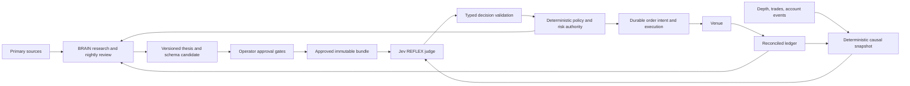

# Autonomous crypto agent: Phase 1 specification for approval

Status: **APPROVED — operator explicitly approved this specification in the conversation. Architecture also approved on October 17, 2026.** Orient completed using installed AgenKit 1.4.0 and a fresh local memory index. No implementation, deployment, live orders, or authenticated Jev calls have been performed for this request. Implementation planning is authorized; the Plan gate precedes implementation.

## Objective and scope

Build a continuously supervised service that researches crypto fundamentals, compiles approved theses into narrow Jev questions, evaluates completed candles, and executes through deterministic policy and risk controls. Success means reliable accounting, causal decisions, controlled failure, auditable evidence, and measured net performance. Neither profitability nor a maximum realized loss can be guaranteed.

The session assistant is Codex; no Claude/Opus identity or availability is assumed. The BRAIN is a separately configured reasoning-provider interface. The operator may select an actually available Anthropic model when credentials and model IDs are verified. Missing BRAIN access pauses escalated strategies. Secrets never enter research documents, snapshots, prompts, or logs.

Recommended first release: one approved spot venue, USD cash accounting, BTC/ETH context, five eligible long candidates at most, hourly closed-candle decisions, continuous depth ingestion, paper then shadow then separately armed limited live operation. The six research candidates are AAVE, HYPE, PENDLE, AERO, LDO, ONDO; this is not a promise that the venue lists them or that they qualify. Spot sells reduce owned inventory. Opening shorts requires a later approved derivatives scope with margin, borrow, funding, liquidation, and venue-specific reconciliation.

Alternative approaches considered:

1. **Extend the current Python platform with independent policy/risk/execution boundaries (recommended).** Reuse existing integrations while replacing incomplete accounting and risk assumptions. Lowest duplication, but existing adapter bypasses need explicit closure.
2. **Separate research and execution services immediately.** Strong process boundaries and independent scaling; adds distributed state, delivery, and deployment complexity before edge validation.
3. **Standalone new trading platform.** Greater isolation; duplicates collectors, dashboard, and deployment and increases migration risk. Not recommended for the first release.

## Existing system and constraints

Read-only orientation found:

| Existing location | Reuse / required correction |
|---|---|
| `bot/live_coinbase_adapter.py:119` | Live arming and mandatory risk callback; add durable pretrade reservation and uncertain-order reconciliation. |
| `bot/risk_gates.py:14` | Kill/deadman/realized loss/position/cash checks; add unrealized loss, high-water drawdown, finite inputs, durable account state. |
| `bot/paper_coinbase_adapter.py:14` | Paper fills with costs; add full cash/equity ledger and gate all execution paths. |
| `data/history.py:23` | SQLite WAL candles; preserve revisions and knowledge time rather than overwrite replay evidence. |
| `data/backtesting.py:46` | Next-bar execution and fees; add depth/slippage, latency, nonfills, availability, and appropriate outcome labels. |
| `dashboard/backend/app.py:355` | Closed-candle deduplication; use separate durable worker and account-level order authority. |
| `deploy/docker-compose.yml:3` | Persistence/restarts/health checks; require reconciliation on startup and execution-aware readiness. |

Existing user changes in README, AGENTS, dashboard, collectors, deployment, and kit files must be preserved. Implementation uses an isolated worktree after the three required design gates.

## Strict BRAIN / REFLEX separation

BRAIN researches, defines labels and rubrics, proposes code/schema revisions, reviews exceptions, and prepares releases. It cannot directly place orders or alter running risk limits. REFLEX evaluates only the approved numeric state and approved question definitions. It has no tools, raw news, exchange credentials, browser, shell, or order privileges. All arithmetic, eligibility, direction-to-action mapping, sizing, order types, routing, and limits belong to code.

## Causal deterministic state requirements

Ingest book sequence updates continuously, maintain a validated local book, and emit a compact snapshot at every accepted book event or block when a source has blocks. Centralized books have sequence numbers, not blockchain blocks. Submit to Jev only on each completed approved candle; superseded decisions must not act. Compute one snapshot per instrument; a shared multi-instrument batch contains the bounded instrument snapshots and shared context once.

Every input carries source event time, local received time, source identity, sequence/block identity, and revision knowledge time. An input may enter a decision only if its event time is at or before the candle cutoff and it was received at or before the decision's knowledge cutoff. Historical fundamentals use publication/receipt time, not the period they describe. Reject clock drift, sequence gaps, crossed/empty books, missing account synchronization, impossible timestamps, and nonfinite values. Reorgs invalidate affected snapshots and outstanding decisions. Out-of-order/late data never silently revise an already logged decision.

Deterministic fields:

- `mid = (best_bid + best_ask) / 2` with positive valid prices.
- `spread_bps = 10000 * (best_ask - best_bid) / mid`.
- `imbalance = (bid_depth - ask_depth)/(bid_depth + ask_depth)` over a fixed approved symmetric depth band, initially proposed 10 bps; zero total depth invalidates the snapshot. Both depths use comparable units.
- Realized volatility: fixed-cadence completed mid-price log returns, sample standard deviation, explicit window, sample count, and annualization. Warmup is invalid rather than zero-volatility. Irregular book-event returns cannot be treated as equal-time samples.
- Inventory in base units and marked USD; liquidation equity includes fees, estimated exit slippage, all balances, and unrealized P&L. Mark stale assets conservatively; unresolved account state blocks orders.
- Drawdown from a durable, external-flow-adjusted high-water equity mark; UTC daily loss from adjusted start-of-day liquidation equity. Include realized/unrealized losses and fees; deposits cannot reset drawdown.
- Past-only momentum, volatility context, market returns, funding/OI changes, macro-event proximity, and candidate evidence freshness/eligibility. Unknown values have explicit validity bits.

Compact numeric state has a versioned ordered field dictionary. Use numeric candidate IDs and booleans as 0/1, fixed units/precision, bounded arrays, and no copied prose. Provenance stays in the audit record outside Jev's market state. **Serialized state must be under 400 provider tokens for the entire call**, not 400 per candidate. Acceptance requires the actual tokenizer or a provider-approved conservative bound; unavailable token accounting blocks promotion rather than claiming compliance from character length. Five/six-candidate compression must be measured. A universe that cannot fit is reduced by deterministic eligibility before evaluation, never by dropping risk fields. Static rubric tokens are budgeted separately and are not a channel for fresh market information.

This is an explicit information bottleneck: Jev cannot rediscover fundamentals from six microstructure numbers. BRAIN supplies approved semantics; deterministic source adapters encode point-in-time thesis status and expiry into numeric state. If that cannot be done faithfully within the token budget, the design must return to the operator.

## Jev contract and per-candidate compilation

TypeSafe's documented endpoint is `POST https://api.typesafe.ai/v1/systemone`, with bearer authentication, `model`, `state`, and `questions`. Questions are independent and share one state; question IDs do not carry semantics into inference. Each instruction must therefore identify the candidate's numeric row explicitly. [Official API reference, accessed October 16](https://docs.typesafe.ai/api), [parallel evaluation description](https://docs.typesafe.ai/introduction).

The documentation now lists `jev-1.14.0`, available October 14, 2026. Pin the validated model rather than `jev-latest`; do not assume calibration transfers between versions. Approximately 81ms is a requested performance target, not a verified latency or service guarantee. Record full-call p50/p95/p99, validation time, candle-to-order delay, errors, and token usage in deployment conditions. [Official models, accessed October 16](https://docs.typesafe.ai/models).

Required normalized domain contract for each candidate:

| Field | Type | Meaning |
|---|---|---|
| regime | `trending / mean_reverting / high_vol / crisis` | Market judgment; cannot override deterministic stress brakes. |
| direction | `long / short / neutral` | Directional judgment at the fixed label horizon. |
| direction_confidence | finite float `[0,1]` | Provider Choice confidence, distinct from outcome probability. |
| direction_probabilities | map over the three directions | Complete validated distribution. |
| toxic_flow | bool | Deterministic threshold applied to Jev's Noul probability. Proposed true at probability >=0.50; missing/invalid blocks. |
| toxic_flow_probability | finite float `[0,1]` | Preserve original probability for evaluation. |
| setup_quality | integer `0..3` | Use a four-option **Choice** with ordered rubric descriptions to obtain an exact integer. |
| risk_state | `safe / near_limit / reduce` | Advisory judgment over numeric headroom; never the risk authority. |

Jev's native Score is a probability-weighted real number, not necessarily an integer. A four-option Choice avoids silently rounding a score across the >=2 boundary. A future native Score implementation would need an explicitly approved conversion and separate validation. [Official Score documentation, accessed October 16](https://docs.typesafe.ai/primitives/score).

Confidence is a statistic derived from the distribution. For three-option Choice, the documented formula means confidence >0.80 corresponds to top class probability >0.8667; neither quantity is automatically the probability of a cost-positive trade. Preserve and validate both. [Official confidence definition, accessed October 16](https://docs.typesafe.ai/confidence).

Compile five independent questions per candidate into **one request**. Shared field meanings remain identical. Proposed quality rubric: 0 invalid/ineligible, 1 incomplete/conflicting confirmation, 2 approved thesis and actionable past-only confirmation, 3 same plus strong corroboration. For every question, explicitly state numeric ID, row position, horizon, units, missing-data behavior, and the candidate condition below. Do not rely on another question's answer being visible.

| Candidate ID | Candidate-specific rubric condition; currently all `eligible=false` |
|---|---|
| 1 AAVE | Executed purchase evidence current, verified net surplus supports purchases, no unresolved budget conflict; book confirms approved long timing. |
| 2 HYPE | Validated net fee absorption versus forward issuance, retained fee-paying activity and venue health; only approved long timing. |
| 3 PENDLE | Realized nonpoints fee retention, current sPENDLE mechanics and emissions verified; liquid PENDLE timing, no assumed staking income. |
| 4 AERO | Organic fees isolated from bribes/subsidies, emissions and migration checked; liquid AERO only, no locked-position cash-flow assumption. |
| 5 LDO | Actual revenue hurdle/deficit cleared and purchases verified; no inferred activation from ETH price alone. |
| 6 ONDO | Verified entitlement gap/supply thesis; neutral in spot release. Short judgment is research-only until derivatives scope approval. |

Validate exact answer keys, resolved model, primitive types, enum membership, finite bounds, distribution completeness/sum tolerance, Choice argmax consistency, snapshot/schema versions, deadlines, and request identity. Malformed/missing/extra/unexpected outputs, timeouts, provider errors, and stale responses produce HOLD and an audit reason. No uncertain retry can result in a duplicate action.

## Deterministic policy, sizing, and hard risk requirements

Entry requires **all** of: eligible approved candidate; valid fresh snapshot/equity; matching immutable release; `setup_quality >=2`; `direction_confidence >0.80` strictly; direction nonneutral and supported by venue/account mode; `risk_state == safe`; toxic_flow false; calibrated net edge positive; and every deterministic risk check passes. `risk_state=safe` alone authorizes nothing. New longs buy; spot sell orders may only reduce held units. Neutral means no new exposure, not automatic liquidation.

Confidence <0.60 or any crisis answer blocks new exposure and writes a deduplicated urgent BRAIN review job containing snapshot, source lineage, decision, inventory, and failures. Confidence exactly 0.60 does not trigger that specific rule but is below the entry threshold. Crisis protection acts immediately and never waits for BRAIN. Review cannot rearm a kill switch. Existing positions remain under preapproved protective exit rules while review is pending.

Kelly requires a separately defined event: proposed initial label is positive **net executable P&L** over the next four completed hourly candles from the first postdecision executable quote, with explicitly modeled exits, fees and slippage. Overlapping labels are purged/embargoed for validation. Log both long and short counterfactuals where executable. Fix a horizon before evaluation; do not change it to improve results.

Let `p` be a conservative calibrated probability for that event, `W>0` the estimated conditional net win per dollar notional, and `L>0` the estimated conditional net loss per dollar notional. With `b=W/L`, binary-loss-budget Kelly is `f*=max(0,p-(1-p)/b)`. Proposed loss budget is `min(0.25*f*, 0.0025)*equity`; convert to notional by dividing by `L`, then cap by notional, liquidity, cash, correlated exposure, and outstanding reservations. The 0.25% equity loss budget is a proposed limit, not a measured optimum. Binary Kelly is only an approximation; full return-distribution/stress analysis must reject sizing when tail losses invalidate it. No validated `p/W/L` means zero risk, never substitution of direction confidence. Never infer a profit probability from synthetic model self-ratings.

Proposed first-release controls, subject to approval:

| Control | Deterministic behavior |
|---|---|
| Drawdown | At **>=15%** adjusted high-water drawdown, durable latch: cancel exposure-increasing orders, block entries, invoke bounded protective exit policy. No automatic reset. Gaps can exceed the threshold. |
| Daily loss | At **>=2%** adjusted UTC opening equity loss, entries blocked and outstanding entry intents canceled; no midnight rearm of a drawdown latch. |
| Position | <=5% equity per asset and <=20% aggregate gross notional, including pending orders and worst-case fills. No leverage. |
| Trade loss budget | <=0.25% equity, additionally capped at quarter Kelly. Stops do not guarantee loss containment. |
| Liquidity/cost | Reject if estimated all-in round-trip cost consumes the conservative edge; fixed venue-specific spread/depth limits established during validation. No unbounded market order. |
| Kill switch | Live execution requires an explicit armed permit and a healthy deadman lease. Triggered/missing/corrupt permit or lease means disabled. Check authoritative state immediately before **every order**, including replacements and exits. |
| Hard kill vs exits | Hard kill cancels all outstanding orders and forbids new orders; operator handles residual inventory. A distinct risk-halt state can allow explicitly authorized reducing-only protective orders. Every exit still checks the kill state, quantity, price bound, account reconciliation, and durable intent. |
| Concurrency | One account order authority atomically checks risk and reserves cash/exposure before intent persistence. Serialize cross-symbol risk and use fencing against duplicate workers. |
| Restart/outage | Reconcile positions, balances, fills, open orders, and unknown intents before readiness. Unknown order acknowledgment never gets blindly resubmitted. |

Execution requires deterministic client order IDs from account/release/candle/candidate/intent, an append-only intent ledger, venue lookup before retry, partial-fill accounting, fee-currency conversion, reservations, tick/lot/notional checks, and separate cancel/reconcile paths. Persistence failure stops trading. Every path, including legacy paper/manual/dashboard endpoints, passes the same order authority.

## Nightly review and governed improvement

Crypto has no universal next open. Run review at a configured UTC boundary and apply approved releases at the next decision boundary. If review, evidence, approval, or deployment is late, retain the still-valid approved bundle or halt when it expires.

1. Freeze an immutable session cutoff and account reconciliation. Account for each fill, partial fill, rejected/canceled order, missed opportunity, no-trade decision, provider failure, and risk veto. Distinguish hypothetical opportunity cost from executable realized P&L.
2. Resolve only matured labels using the fixed horizon; pending labels remain pending. Use all eligible forecasts, not just fills, and report the selected-trade subset separately. Log reasons for unresolvable counterfactuals to expose missingness bias.
3. Compute binary Brier `mean((p-y)^2)` for fixed net-positive labels, multiclass Brier for direction labels, sample counts, base-rate baseline, reliability bins, uncertainty intervals, regime/asset splits, net P&L, turnover, tail losses, latency and nonfill rates. Do not score vendor confidence against wins as if it were probability.
4. BRAIN proposes a schema/calibrator change with a falsifiable reason and diff; preserve model, tokenizer, question bundle, policy, dataset, and calibration versions. A quiet night can propose no change.
5. Run chronological walk-forward evaluation with purging, embargo, unseen holdout, realistic costs, stress events, and comparison with a deterministic baseline. Promotion must require positive net evidence and no degraded hard-risk behavior. Too few independent labels means no calibration/promotion claim; finalize sample/power criteria at the Plan gate.
6. Pass changed scope through AgenKit spec, architecture, plan, test-first build, review, and ship gates. Operator approval is still required; generating a candidate overnight is authorized, silently deploying it is not. Deploy atomically with rollback and expiry checks.

BRAIN provider failure, calibration drift, data drift, or expired thesis evidence can reduce exposure eligibility. None can relax a numeric risk ceiling. Nightly adaptation must not repeatedly tune against the same holdout.

## Six-phase delivery roadmap and exact proposed paths

This roadmap makes the requested scope reviewable at the first gate. It is not an approved Phase 2 architecture or Phase 3 implementation plan.

| Phase / approval | Deliverables and proposed paths |
|---|---|
| 0 Orient — done | Existing `.agenkit/memory/` queried; source map above. Installed kit verified against `https://agenkit.xyz`; reinstall unnecessary. |
| 1 Brainstorm/spec — **approved** | This file; `docs/research/2026-10-16-autonomous-agent/RESEARCH.md`; `docs/research/2026-10-16-autonomous-agent/evidence/`. |
| 2 Architecture — separate gate | `docs/architecture/2026-10-16-autonomous-crypto-agent.md`; `docs/ADR/2026-10-16-brain-reflex-boundaries.md`; specify interfaces, data schemas, crash recovery, venue/mode, and fail-closed authority. |
| 3 Plan — separate gate | `docs/plans/2026-10-16-autonomous-crypto-agent.md`; ordered RED/GREEN tasks, exact paths, fixtures, failure cases, acceptance evidence, migration and rollout. |
| 4 Build — separate completion gate | `bot/autonomous/contracts.py`, `state.py`, `jev_client.py`, `policy.py`, `risk.py`, `sizing.py`, `execution.py`, `ledger.py`, `worker.py`, `brain.py`, `nightly.py`, `calibration.py`; `research/autonomous/evidence.py`, `valuation.py`; `config/autonomous/risk.yaml`; `config/autonomous/schemas/{aave,hype,pendle,aero,ldo,ondo}.json`; `data/migrations/001_autonomous_ledger.sql`. Integrate named existing adapters only after approved contracts. |
| 5 Review — separate gate | `docs/reviews/2026-10-16-autonomous-crypto-agent.md`; independent spec compliance, accounting, security, causal leakage, numerical boundary, execution retry, and deployment findings. Critical/Important findings block ship. |
| 6 Ship — separate merge/deploy/live gates | `deploy/autonomous.compose.yml`, `docs/runbooks/autonomous-agent.md`, `.github/workflows/autonomous-agent.yml`; paper → shadow → limited live, rollback proof, reconciliation and kill-switch drill; live arming remains explicit. |

Proposed meaningful acceptance tests: `tests/autonomous/test_causality.py`, `test_state.py`, `test_jev_contract.py`, `test_policy_boundaries.py`, `test_risk_limits.py`, `test_sizing.py`, `test_execution_recovery.py`, `test_ledger.py`, `test_nightly.py`, `test_release_promotion.py`. Build phase follows the user-requested test-first process. No tests have been added or run at this specification stage.

Acceptance includes: strict 0.80/0.60 boundaries, 15% drawdown and 2% daily-loss inclusivity, nonfinite and missing inputs, restart-persistent latches, deposits/withdrawals, simultaneous orders, fills during cancellation, duplicate events, unknown venue acknowledgment, partial fills, poisoned text excluded from snapshots, expired schemas, provider model changes, warmup, candle cutoff/receipt ordering, book gaps/reorgs, token-budget enforcement, and halted release promotion.

## Gate decision

The operator approved this specification to proceed to Architecture. Approval accepts the stated initial spot/paper scope, conservative proposed limits, six provisional candidates with no approved trades, source gaps, and an external configurable BRAIN rather than a claim that this Codex session is Opus. Live venue, funded capital, available model credentials, and exact listings can be resolved at their dependent gates; they are not reasons to invent current values.

The AgenKit workflow explicitly requires separate spec, architecture, and plan approvals before implementation. No approval is presumed from elapsed time or the original request to build.

## WHAT COULD I BE WRONG ABOUT?

The six theses may offer no tradable edge; Jev may add latency without information beyond deterministic features; calibrated probabilities may fail out of distribution; the 400-token bottleneck may discard necessary context; binary Kelly may understate fat-tail loss; and a nominal 15% drawdown brake can be overrun by market gaps or venue failure. Research activity and token value accrual may diverge. Incentive-adjusted, cost-positive, unseen performance is required before risking funds, and an empty trading universe is acceptable.
